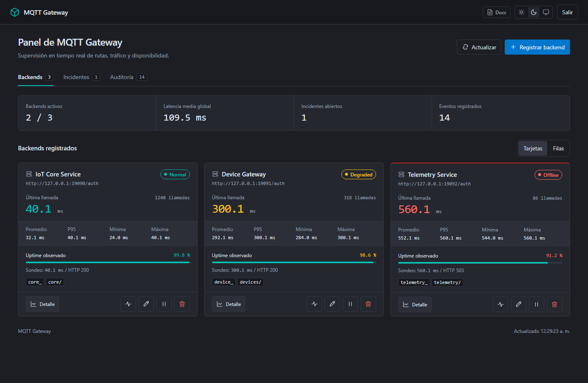
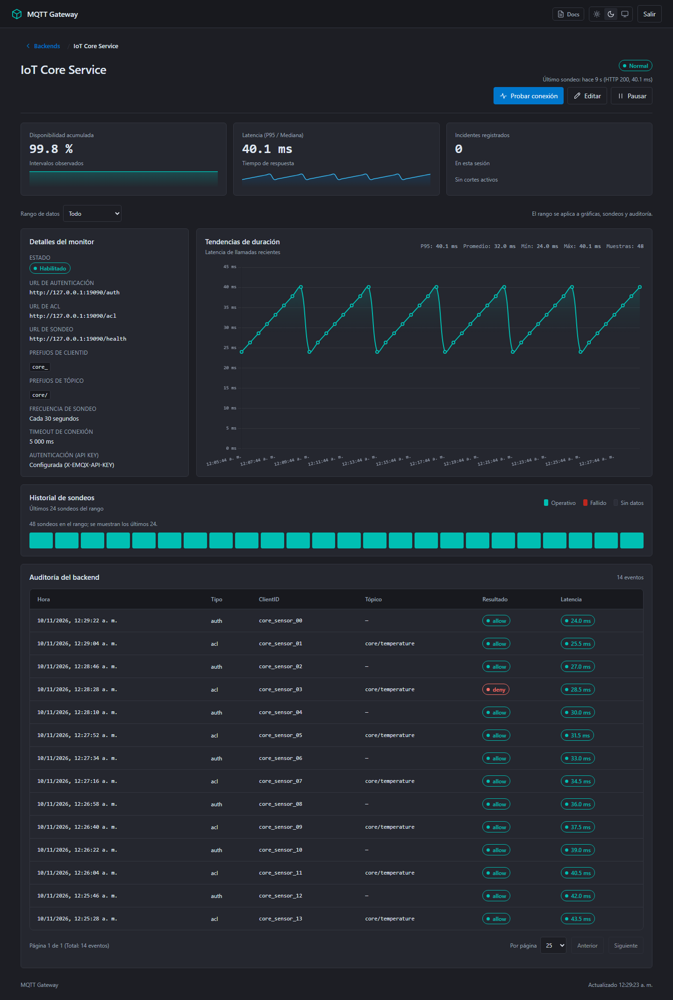
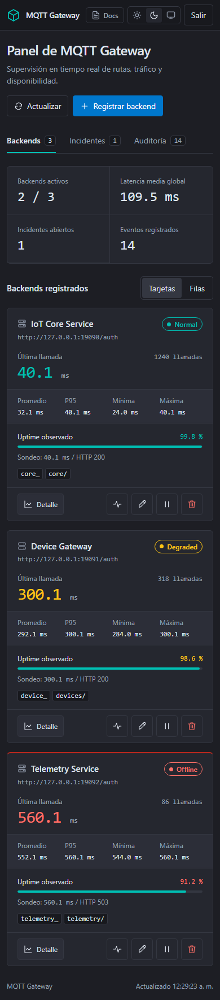

# MQTT Gateway

[English](README.md) | [Español](README.es.md)

**Centraliza la autenticación MQTT y los permisos de tópicos en un gateway HTTP.**

Conecta EMQX, Mosquitto y VerneMQ con tus backends HTTP sin mantener una política
de enrutamiento distinta por bróker. Administra rutas, consulta sondeos de salud
y revisa decisiones de acceso desde un único panel.



*UI real con datos ilustrativos; no es una medición de rendimiento.
El panel administrativo actual está en español.*

## Pruébalo en tu equipo

La [guía de inicio rápido](docs/quickstart.es.md) permite ejecutar un backend HTTP
en Python, iniciar el gateway y enviar solicitudes con resultados `allow`, `deny`
e `ignore`. Esa demostración HTTP no necesita bróker MQTT, base de datos,
instalación de Docker ni una cuenta EMQX.

Requisitos: **JDK 25**, Python 3, Git y curl en **Linux o WSL**. La ejecución
nativa de Windows todavía no está soportada porque el almacenamiento utiliza
permisos POSIX. En Windows sí se puede compilar el JAR.

```sh
git clone https://github.com/kgvicente/mqtt-gateway.git
cd mqtt-gateway
./mvnw package
```

Continúa con la [configuración de la demo y primeras solicitudes](docs/quickstart.es.md).

## Cuándo utilizarlo

- Varios prefijos de clientes o tópicos necesitan distintos backends HTTP.
- Quieres cambiar las rutas sin reiniciar el gateway.
- Necesitas consultar salud, latencia y decisiones de acceso en un mismo panel.
- Quieres un acceso administrativo que pueda funcionar sin EMQX.

Este gateway gestiona autenticación y autorización por HTTP. **No reenvía
mensajes MQTT** ni sustituye la capa de transporte del bróker.

## Adaptadores de brókers

Todas las rutas son relativas a `/api/v1/gateway` y utilizan HTTP POST.

| Adaptador | Autenticación | Permisos de tópicos | Respuesta |
| --- | --- | --- | --- |
| EMQX | `/emqx/auth` | `/emqx/acl` | JSON `result: allow / deny / ignore` |
| Mosquitto con mosquitto-go-auth | `/mosquitto/auth` | `/mosquitto/acl` | HTTP `200 / 400 / 404` |
| VerneMQ con vmq_webhooks | `/vernemq/auth` | `/vernemq/acl` | JSON `ok / error / next` dentro de `result` |
| HTTP genérico | `/generic/auth` | `/generic/acl` | JSON `allowed` y `status` |

Las rutas existentes `/auth` y `/acl` conservan el contrato EMQX. Las solicitudes
salientes utilizan un contrato JSON compartido y una API key opcional por backend.
Consulta la [referencia de adaptadores](docs/reference.es.md#adaptadores-mqtt)
para ver payloads y configuración.

## Administración y observabilidad

- Crear, editar, pausar y probar rutas desde el panel.
- Alternar tarjetas y filas paginadas; filtrar auditoría por cliente, tópico y rango.
- Consultar sondeos con fecha, tendencias de latencia e historial de incidentes.
- Autenticación administrativa interna o delegada a EMQX. Las sesiones internas
  caducan a las ocho horas y se pierden al reiniciar.
- Rutas y estado operativo en archivos JSON locales, sin base de datos.

<details>
<summary>Detalle del backend y vista móvil</summary>





Las capturas contienen datos ilustrativos. No acreditan rendimiento MQTT ni
certifican interoperabilidad con brókers reales.

</details>

## Validación y límites actuales

La suite smoke ejecuta un proceso real del gateway con estado aislado y
dependencias HTTP simuladas. Comprueba autenticación administrativa, contratos
de adaptadores, cambios de rutas, claves salientes, timeouts, sondeos, incidentes
y persistencia.

```sh
python3 scripts/smoke.py
```

Ejecútala en Linux o WSL después de compilar el JAR; utiliza el puerto 18085.
Las pruebas de contrato HTTP no sustituyen las pruebas de extremo a extremo con
brókers MQTT activos. Esa validación sigue siendo necesaria antes de anunciarla
para una versión.

La auditoría y los sondeos muestran datos retenidos con la rotación diaria
existente. No hay almacenamiento distribuido ni coordinación de alta disponibilidad.

## Documentación y contribuciones

- [Inicio rápido](docs/quickstart.es.md) · [Quick start in English](docs/quickstart.md)
- [Referencia técnica](docs/reference.es.md)
- [Manual de operaciones](MANUAL_OPERACIONES.md)
- [Política de contribuciones y revisión](CONTRIBUTING.md)

Si encuentras un problema, [abre un issue](https://github.com/kgvicente/mqtt-gateway/issues)
con la versión del bróker/complemento, un ejemplo mínimo y el resultado esperado.
Elimina contraseñas y tokens antes de compartir solicitudes.

Si el proyecto te resulta útil, considera darle una estrella para seguir su evolución.

## Licencia

El código propio es de **código visible** bajo
[PolyForm Noncommercial License 1.0.0](LICENSE). Los usos comerciales fuera de sus
permisos requieren una licencia aparte del titular; contacta con
[@kgvicente](https://github.com/kgvicente). No es una licencia de código abierto
sin restricciones. Los componentes de terceros conservan [sus licencias](NOTICE).

El proyecto es independiente y no está afiliado ni respaldado por EMQX, Mosquitto,
VerneMQ o sus titulares. Sus nombres y marcas pertenecen a sus respectivos dueños.
