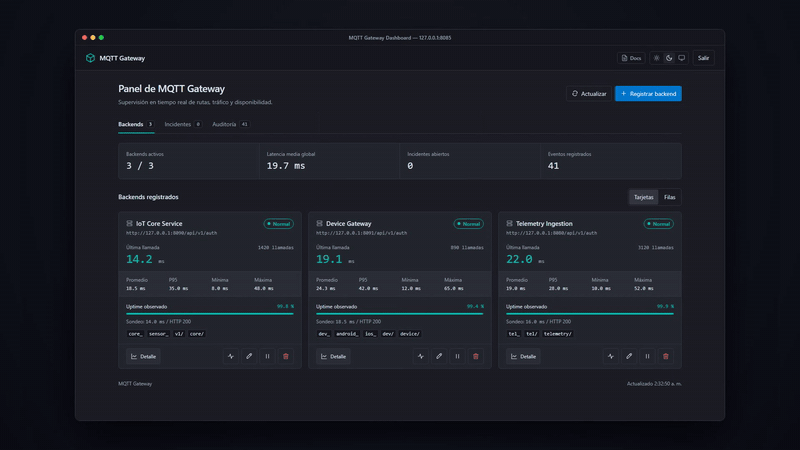
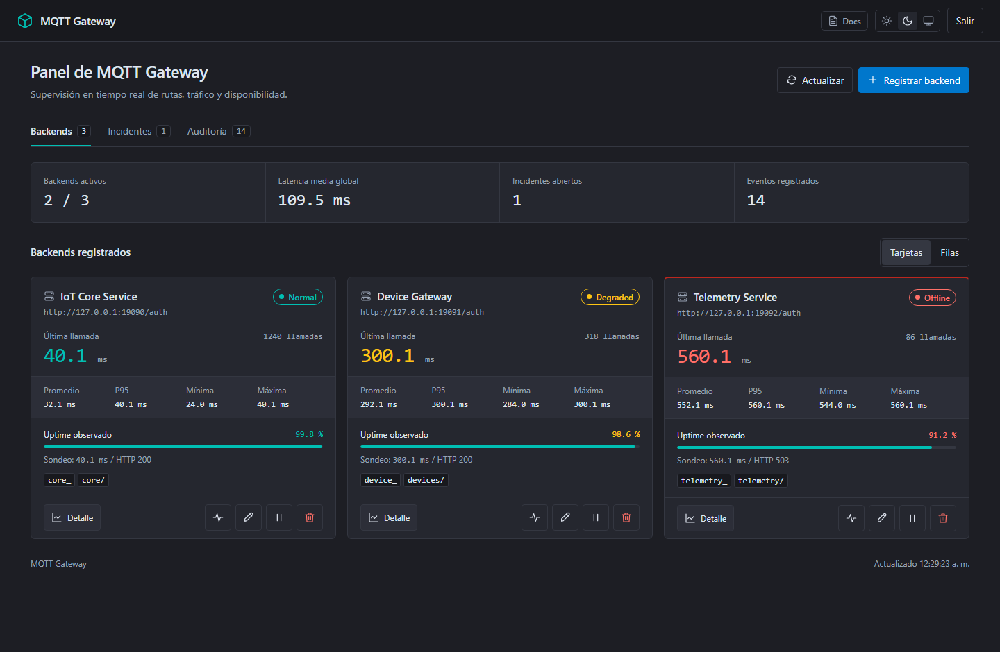
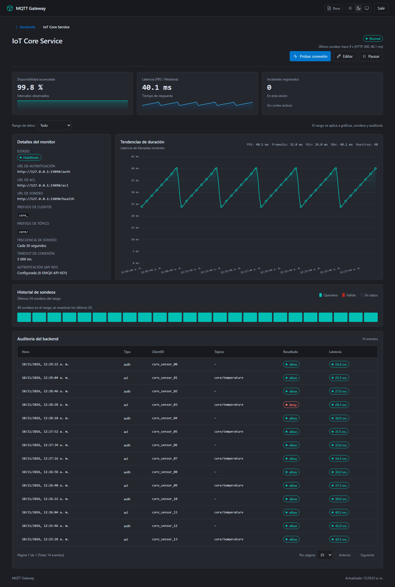
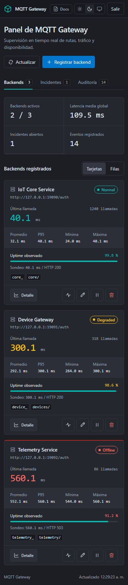

# MQTT Gateway

[English](README.md) | [Español](README.es.md)

[](https://github.com/kgvicente/mqtt-gateway/actions/workflows/ci.yml)
[](LICENSE)
[](pom.xml)
[](https://quarkus.io)
[](compose.yaml)

**Centraliza la autenticación MQTT y los permisos de tópicos en un gateway HTTP.**

Conecta EMQX, Mosquitto y VerneMQ con tus backends HTTP sin mantener una política
de enrutamiento distinta por bróker. Administra rutas, consulta sondeos de salud
y revisa decisiones de acceso desde un único panel.



*UI real con datos ilustrativos; no es una medición de rendimiento.
El panel administrativo actual está en español.*

## Pruébalo en tu equipo

> [!NOTE]
> **Compilación local e imagen de contenedor en registro:**
> El código fuente de este checkout incorpora las características de **secretos administrados desde el panel con cifrado AES-256-GCM**, outbox transaccional y clave maestra obligatoria. La imagen del registro (`ghcr.io/kgvicente/mqtt-gateway:latest`) se actualiza únicamente tras la ejecución exitosa del pipeline de integración continua (CI) sobre la rama principal (`main`). Los comandos de compilación local (`docker build -t mqtt-gateway:local .` o `docker compose up --build`) reproducen fielmente en todo momento el código exacto de este checkout.

### Inicio rápido con contenedor local

Para ejecutar de manera reproducible el código exacto de este checkout sin depender de la publicación de imágenes en el registro por el pipeline de CI, compila y ejecuta el contenedor localmente:

```sh
# 1. Compilar la imagen localmente desde el repositorio:
docker build -t mqtt-gateway:local .

# 2. Ejecutar con volumen persistente para SQLite y tu master.env fuera del repositorio:
master_env_path="${XDG_CONFIG_HOME:-$HOME/.config}/mqtt-gateway/master.env"
docker run -d --name mqtt-gateway -p 127.0.0.1:18085:8085 \
  --env-file "$master_env_path" \
  -e GATEWAY_ADMIN_AUTH_PROVIDER=internal \
  -e GATEWAY_ADMIN_PASSWORD=local-demo-admin-2026 \
  -v gateway-data:/app/data \
  mqtt-gateway:local
```

*(En Windows PowerShell: `docker build -t mqtt-gateway:local .`; `$masterEnvPath = Join-Path $env:USERPROFILE '.config\mqtt-gateway\master.env'`; luego `docker run -d --name mqtt-gateway -p 127.0.0.1:18085:8085 --env-file $masterEnvPath -e GATEWAY_ADMIN_AUTH_PROVIDER=internal -e GATEWAY_ADMIN_PASSWORD=local-demo-admin-2026 -v gateway-data:/app/data mqtt-gateway:local`).*

Consulta el [procedimiento de generación segura de master.env fuera del repo en la guía de Telegram](docs/telegram-docker.es.md#2-preparación-de-la-clave-maestra-masterenv).

Abre <http://127.0.0.1:18085/gateway/> e ingresa con `admin` / `local-demo-admin-2026`.

### Demostración MQTT real con Docker Compose

Para una demostración MQTT real con Mosquitto y pruebas automatizadas, usa **Docker Compose 2.20+ con contenedores Linux**
en un equipo AMD64. Docker Desktop puede ejecutarlos en Windows. Esta opción no
requiere JDK, Python ni clientes MQTT instalados en el host.

Antes de iniciar por primera vez, genera tu archivo privado `master.env` fuera del repositorio (en Bash: `master_env_path="${XDG_CONFIG_HOME:-$HOME/.config}/mqtt-gateway/master.env"`; en PowerShell: `$masterEnvPath = Join-Path $env:USERPROFILE '.config\mqtt-gateway\master.env'`). Todos los comandos deben incluir `--env-file`:

```sh
git clone https://github.com/kgvicente/mqtt-gateway.git
cd mqtt-gateway

# Iniciar la composición reutilizando tu master.env persistido:
docker compose --env-file "$master_env_path" up --build --wait
```

*(En Windows PowerShell: `docker compose --env-file $masterEnvPath up --build --wait`)*

Abre <http://127.0.0.1:18085/gateway/> e ingresa con
`admin` / `local-demo-admin-2026`. Son credenciales públicas de la demo local.

```sh
# Ejecutar las comprobaciones automáticas de MQTT:
docker compose --env-file "$master_env_path" --profile test run --rm mqtt-tests
```

*(En Windows PowerShell: `docker compose --env-file $masterEnvPath --profile test run --rm mqtt-tests`)*

Las pruebas comprueban entrega real de mensajes MQTT 5 y rechazo de contraseñas,
publicaciones y suscripciones no autorizadas. Consulta la
[guía de Compose](docs/compose.es.md) para ver puertos, limpieza y límites de las imágenes.

### Compilar sin Docker

La [guía de inicio rápido](docs/quickstart.es.md) permite ejecutar un backend HTTP
en Python, iniciar el gateway y enviar solicitudes con resultados `allow`, `deny`
e `ignore`. Esa demostración HTTP no necesita bróker MQTT, base de datos,
instalación de Docker ni una cuenta EMQX.

Requisitos: **JDK 25**, Python 3, Git y curl en **Linux o WSL**. La ejecución
nativa de Windows todavía no está soportada porque el almacenamiento utiliza
permisos POSIX. En Windows sí se puede compilar el JAR.

```sh
git clone https://github.com/kgvicente/mqtt-gateway.git
cd mqtt-gateway
./mvnw package
```

Continúa con la [configuración de la demo y primeras solicitudes](docs/quickstart.es.md).

## Cuándo utilizarlo

- Varios prefijos de clientes o tópicos necesitan distintos backends HTTP.
- Quieres cambiar las rutas sin reiniciar el gateway.
- Necesitas consultar salud, latencia y decisiones de acceso en un mismo panel.
- Quieres un acceso administrativo que pueda funcionar sin EMQX.

Este gateway gestiona autenticación y autorización por HTTP. **No reenvía
mensajes MQTT** ni sustituye la capa de transporte del bróker.

## Adaptadores de brókers

Todas las rutas son relativas a `/api/v1/gateway` y utilizan HTTP POST.

| Adaptador | Autenticación | Permisos de tópicos | Respuesta |
| --- | --- | --- | --- |
| EMQX | `/emqx/auth` | `/emqx/acl` | JSON `result: allow / deny / ignore` |
| Mosquitto con mosquitto-go-auth | `/mosquitto/auth` | `/mosquitto/acl` | HTTP `200 / 400 / 404` |
| VerneMQ con vmq_webhooks | `/vernemq/auth` | `/vernemq/acl` | JSON `ok / error / next` dentro de `result` |
| HTTP genérico | `/generic/auth` | `/generic/acl` | JSON `allowed` y `status` |

Las rutas existentes `/auth` y `/acl` conservan el contrato EMQX. Las solicitudes
salientes utilizan un contrato JSON compartido y una API key opcional por backend.
Consulta la [referencia de adaptadores](docs/reference.es.md#adaptadores-mqtt)
para ver payloads y configuración.

## Administración y observabilidad

- Crear, editar, pausar y probar rutas desde el panel.
- Alternar tarjetas y filas paginadas; filtrar auditoría por cliente, tópico y rango.
- Consultar sondeos con fecha, tendencias de latencia e historial de incidentes.
- Autenticación administrativa interna o delegada a EMQX. Las sesiones internas
  caducan a las ocho horas y se pierden al reiniciar.
- Rutas, ajustes, incidentes y checkpoints en base de datos SQLite integrada (`data/gateway.db`) en modo WAL, sin requerir servidores de base de datos externos.
- Monitoreo configurable en caliente: intervalo de sondeo, timeout y umbrales de fallos (corte) y éxitos (recuperación) con herencia por backend y estimación aproximada de detección.
- Notificaciones de incidentes en tiempo real vía Telegram mediante outbox transaccional, entrega at-least-once, herencia por ruta y control de rate limits oficial.
- Gestión de secretos administrados desde el panel con cifrado AES-256-GCM en base de datos SQLite y clave maestra obligatoria de infraestructura (`GATEWAY_MASTER_KEY` de 32 bytes Base64). Campos *write-only* (`apiKey`, `botToken`) y caché privada en memoria RAM; eliminación de `apiKeyEnv`.
- Sembrado inicial de rutas mediante YAML; importación transaccional de datos legados y copias de seguridad offline considerando archivos WAL.

## Desarrolla con Agentes de IA (Cursor, Claude, Copilot)

Si utilizas asistentes o agentes de desarrollo con IA como **Cursor**, **Claude Code**, **GitHub Copilot**, **Windsurf** o **ChatGPT**, puedes copiar y pegar el siguiente prompt para que tu asistente implemente tu backend o conecte tu bróker MQTT:

```text
Ayúdame a crear un servicio de backend para MQTT Gateway. Lee primero la especificación técnica en https://raw.githubusercontent.com/kgvicente/mqtt-gateway/main/docs/llms.txt (o /gateway/llms.txt) y guíame paso a paso para implementar los endpoints /auth, /acl y /health.
```

- **Especificación para Agentes:** [`docs/llms.txt`](docs/llms.txt) y [`docs/llms-full.txt`](docs/llms-full.txt).
- **Negociación de Contenido HTTP:** Consultar `/gateway/docs` con la cabecera `Accept: text/markdown` o acceder a `/gateway/docs.md` devuelve Markdown puro optimizado para ventanas de contexto.
- **Botón Copiar Prompt en la Documentación:** En `/gateway/docs` dispones de un botón directo de copiado y pestañas de contexto (desarrollo de backend, configuración de bróker y onboarding rápido).

<details>
<summary>Capturas estáticas del panel y vista móvil</summary>







Las capturas contienen datos ilustrativos. No acreditan rendimiento MQTT ni
certifican interoperabilidad con brókers reales.

</details>

## Validación y límites actuales

La suite smoke ejecuta un proceso real del gateway con estado aislado y
dependencias HTTP simuladas. Comprueba autenticación administrativa, contratos
de adaptadores, cambios de rutas, claves salientes, timeouts, sondeos, incidentes
y persistencia.

```sh
python3 scripts/smoke.py
```

Ejecútala en Linux o WSL después de compilar el JAR; utiliza el puerto 18085.
La suite Compose valida Mosquitto 2.0.15 con la imagen fijada de mosquitto-go-auth
y MQTT 5. EMQX y VerneMQ tienen pruebas de contrato HTTP; esta versión no certifica
su interoperabilidad MQTT real. El complemento de la demo está archivado en su
origen y se utiliza para evaluación local.

La auditoría y los sondeos muestran datos retenidos con la rotación diaria
existente. No hay almacenamiento distribuido ni coordinación de alta disponibilidad.

## Documentación y contribuciones

- [Docker Compose / demo MQTT real](docs/compose.es.md)
- [Cambios de la versión](CHANGELOG.md) · [Descargas](https://github.com/kgvicente/mqtt-gateway/releases)
- [Inicio rápido](docs/quickstart.es.md) · [Quick start in English](docs/quickstart.md)
- [Referencia técnica](docs/reference.es.md)
- [Manual de operaciones](MANUAL_OPERACIONES.md)
- [Telegram en Docker Compose](docs/telegram-docker.es.md)
- [Las tres fases del gateway](docs/three-phases.es.md)
- [Política de contribuciones y revisión](CONTRIBUTING.md)

Si encuentras un problema, [abre un issue](https://github.com/kgvicente/mqtt-gateway/issues)
con la versión del bróker/complemento, un ejemplo mínimo y el resultado esperado.
Elimina contraseñas y tokens antes de compartir solicitudes.

Si el proyecto te resulta útil, considera darle una estrella para seguir su evolución.

## Licencia

El código de este proyecto es software libre bajo los términos de la **[GNU Affero General Public License v3.0 (AGPL-3.0)](LICENSE)**.

### Licenciamiento comercial
Si tu organización necesita utilizar, incrustar o distribuir MQTT Gateway sin las obligaciones copyleft de la AGPL-3.0 (por ejemplo, dentro de software propietario cerrado o plataformas comerciales privadas), ofrecemos licencias comerciales propietarias y acuerdos de soporte. Para consultas y acuerdos de licencia, contacta con [@kgvicente](https://github.com/kgvicente).

Los componentes de terceros conservan [sus licencias](NOTICE).

El proyecto es independiente y no está afiliado ni respaldado por EMQX, Mosquitto,
VerneMQ o sus titulares. Sus nombres y marcas pertenecen a sus respectivos dueños.
