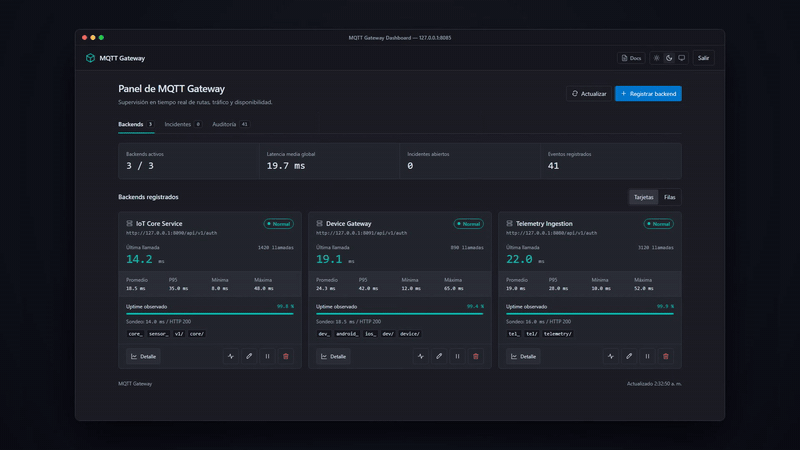
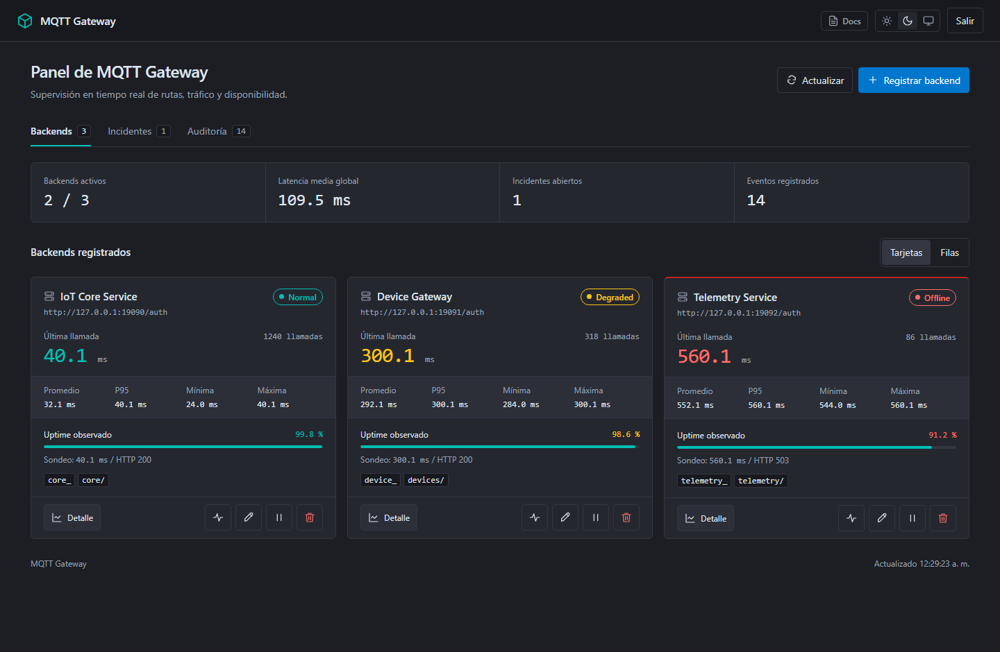
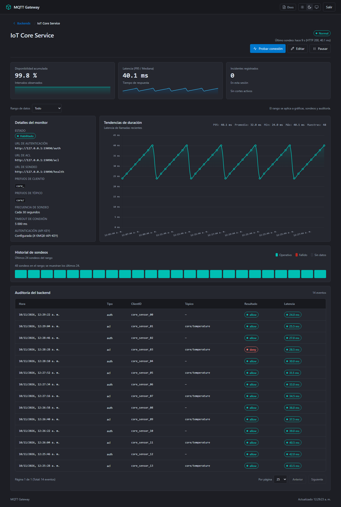
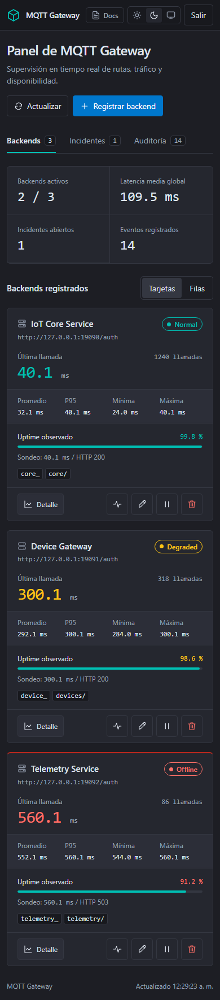

# MQTT Gateway

[English](README.md) | [Español](README.es.md)

**Route MQTT authentication and topic permissions through one HTTP gateway.**

Connect EMQX, Mosquitto and VerneMQ to your HTTP backends without maintaining a
separate routing policy for each broker. Manage routes, inspect health probes
and review access decisions from a single admin panel.



*Actual UI with illustrative data, not a performance benchmark.
The current admin UI is in Spanish.*

## Try it locally

For a real MQTT demonstration, use **Docker Compose 2.20+ with Linux containers**
on an AMD64 machine. Docker Desktop can provide those containers on Windows.
No host JDK, Python or MQTT clients are needed for this path.

```sh
git clone https://github.com/kgvicente/mqtt-gateway.git
cd mqtt-gateway
docker compose up --build --wait
```

Open <http://127.0.0.1:18085/gateway/> and sign in with
`admin` / `local-demo-admin-2026`. These are public, local-demo credentials.

```sh
docker compose --profile test run --rm mqtt-tests
```

The tests check real MQTT 5 message delivery and reject incorrect passwords,
unauthorized publications and unauthorized subscriptions. See the
[Compose guide](docs/compose.md) for ports, cleanup and image limitations.

### Build without Docker

The [hands-on quick start](docs/quickstart.md) runs a Python HTTP backend and a
gateway instance, then demonstrates `allow`, `deny` and `ignore`. No MQTT broker,
database, Docker installation or EMQX account is required for this HTTP demo.

Requirements: **JDK 25**, Python 3, Git and curl on **Linux or WSL**. Native Windows
runtime execution is not currently supported because the state store uses POSIX
permissions. Windows can compile the JAR.

```sh
git clone https://github.com/kgvicente/mqtt-gateway.git
cd mqtt-gateway
./mvnw package
```

Continue with the [demo setup and first requests](docs/quickstart.md).

## When it fits

- Several MQTT client or topic prefixes need different HTTP backends.
- You want to change backend routes without restarting the gateway.
- You need a shared view of backend health, latency and access decisions.
- You want administrative access that can run independently of EMQX.

This is an HTTP authentication/authorization gateway. It does **not forward
MQTT messages** or replace the broker's transport layer.

## Broker adapters

All paths are relative to `/api/v1/gateway` and use HTTP POST.

| Adapter | Authentication | Topic permissions | Response |
| --- | --- | --- | --- |
| EMQX | `/emqx/auth` | `/emqx/acl` | JSON `result: allow / deny / ignore` |
| Mosquitto with mosquitto-go-auth | `/mosquitto/auth` | `/mosquitto/acl` | HTTP `200 / 400 / 404` |
| VerneMQ with vmq_webhooks | `/vernemq/auth` | `/vernemq/acl` | JSON `ok / error / next` under `result` |
| Generic HTTP | `/generic/auth` | `/generic/acl` | JSON `allowed` and `status` |

The existing `/auth` and `/acl` paths keep the EMQX contract. Backend requests use
the shared JSON contract and an optional API key per backend.
See the [adapter reference in Spanish](docs/reference.es.md#adaptadores-mqtt)
for payloads and configuration.

## Administration and observability

- Create, edit, pause and test routes from the panel.
- Switch between cards and paginated rows; filter audit events by client, topic
  and time range.
- Inspect dated probes, latency trends and incident history.
- Use internal administrative authentication or delegate it to EMQX. Internal
  tokens expire after eight hours and are lost on restart.
- Store routes and operational state in local JSON files, without a database.

## 🤖 Build with AI Coding Agents (Cursor, Claude, Copilot)

If you use AI coding assistants such as **Cursor**, **Claude Code**, **GitHub Copilot**, **Windsurf**, or **ChatGPT**, you can copy and paste the prompt below to automatically build your backend service or integrate your MQTT broker:

```text
Help me implement a backend service for MQTT Gateway. Read https://raw.githubusercontent.com/kgvicente/mqtt-gateway/main/docs/llms.txt (or /gateway/llms.txt) first, then walk me through building the /auth, /acl, and /health endpoints step by step.
```

- **Technical Reference for Agents:** [`docs/llms.txt`](docs/llms.txt) and [`docs/llms-full.txt`](docs/llms-full.txt).
- **HTTP Content Negotiation:** Querying `/gateway/docs` with `Accept: text/markdown` or requesting `/gateway/docs.md` serves pure Markdown designed for LLM context windows.
- **Copy Prompt in UI:** The web documentation at `/gateway/docs` includes a 1-click **"Copy Prompt"** button and context tabs for backend development, broker configuration, and fast onboarding.

<details>
<summary>Static dashboard screenshots and mobile view</summary>







Screenshots use illustrative data and do not establish real broker throughput
or an interoperability certification.

</details>

## Validation and current limits

The smoke suite runs a real gateway process with isolated state and mock HTTP
dependencies. It checks administrative authentication, adapter contracts, route
changes, API keys, timeouts, probes, incidents and persistence.

```sh
python3 scripts/smoke.py
```

Run this on Linux or WSL after building the JAR. The suite uses port 18085.
The Compose suite validates Mosquitto 2.0.15 with the pinned mosquitto-go-auth
image and MQTT 5. EMQX and VerneMQ currently have HTTP contract tests; this release
does not certify their real-broker interoperability. The demo plugin is archived
upstream and is used for local evaluation.

Audit and probe views cover retained data with the existing daily rotation.
There is no distributed state store or high-availability coordination.

## Documentation and contributions

- [Docker Compose / real MQTT demo](docs/compose.md)
- [Release notes](CHANGELOG.md) · [Downloads](https://github.com/kgvicente/mqtt-gateway/releases)
- [Quick start](docs/quickstart.md) · [Inicio rápido en español](docs/quickstart.es.md)
- [Technical reference, Spanish](docs/reference.es.md)
- [Operations manual, Spanish](MANUAL_OPERACIONES.md)
- [Contribution and review policy](CONTRIBUTING.md)

[Report an issue](https://github.com/kgvicente/mqtt-gateway/issues) with the
broker/plugin version, a minimal example and the expected result. Remove passwords
and tokens before sharing request data.

If this project is useful to you, consider starring the repository to follow
its development.

## License

Project-owned code is licensed under the **[GNU Affero General Public License v3.0 (AGPL-3.0)](LICENSE)**.

### Commercial Licensing
If your organization needs to use, embed, or deliver MQTT Gateway without the copyleft obligations of the AGPL-3.0 (for example, inside closed-source proprietary software or proprietary commercial platforms), commercial licenses and support agreements are available. Contact [@kgvicente](https://github.com/kgvicente) for commercial inquiries.

Third-party components retain their [own licenses](NOTICE).

This independent project is not affiliated with or endorsed by EMQX, Mosquitto,
VerneMQ or their respective owners. Their names and trademarks belong to them.
