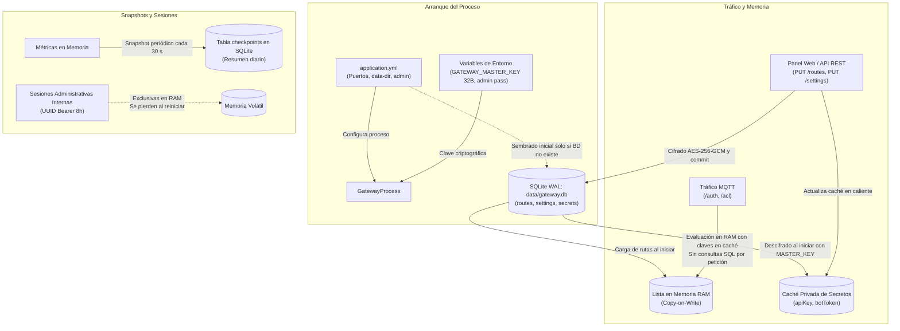
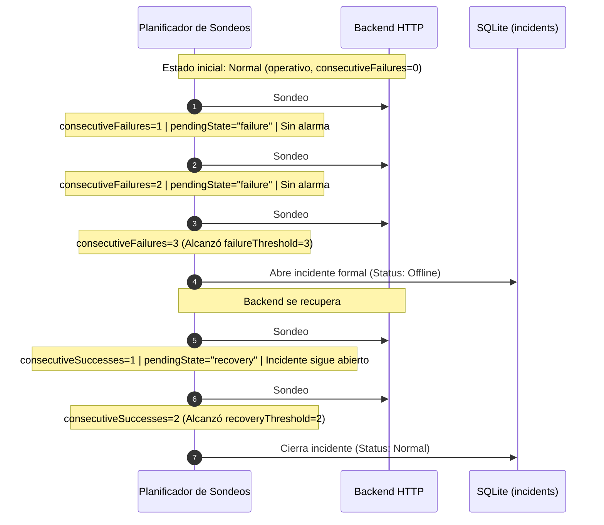
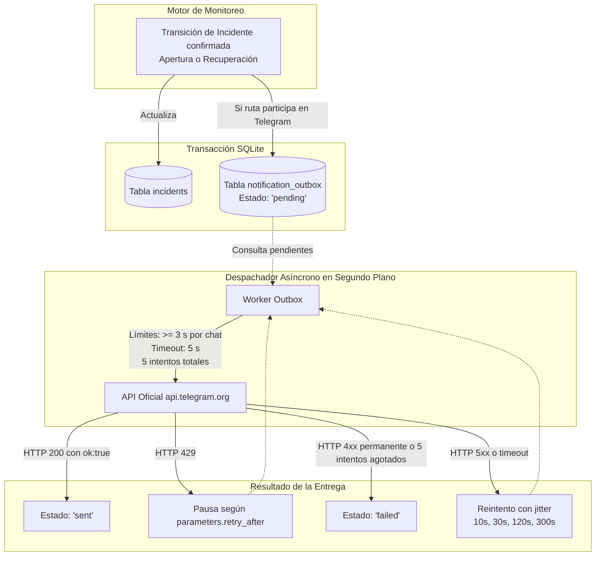

# Las tres fases del gateway

Este documento describe el funcionamiento interno, el flujo de datos y la arquitectura técnica de **MQTT Gateway**, explicando cómo interactúan sus tres fases de desarrollo: persistencia en SQLite, supervisión activa de salud y notificaciones por Telegram mediante outbox transaccional.

> [!NOTE]
> **Alcance de la Arquitectura y Fuente de Verdad:**
> La arquitectura del gateway está diseñada para operar como **una única instancia local con almacenamiento SQLite en disco local**. No añade capas de clustering, replicación multi-nodo ni alta disponibilidad distribuida.
> El código fuente del repositorio ([AdminResource.java](https://github.com/kgvicente/mqtt-gateway/blob/main/src/main/java/pe/gateway/AdminResource.java), [GatewayState.java](https://github.com/kgvicente/mqtt-gateway/blob/main/src/main/java/pe/gateway/GatewayState.java), [StorageService.java](https://github.com/kgvicente/mqtt-gateway/blob/main/src/main/java/pe/gateway/StorageService.java), [GatewayConfig.java](https://github.com/kgvicente/mqtt-gateway/blob/main/src/main/java/pe/gateway/GatewayConfig.java), [application.yml](https://github.com/kgvicente/mqtt-gateway/blob/main/src/main/resources/application.yml)) es la máxima autoridad técnica y contractual del sistema. Planes y reportes de auditoría son antecedentes históricos.

---

## Índice

1. [Fase 1: Persistencia Operativa y Flujo de Configuración](#fase-1-persistencia-operativa-y-flujo-de-configuración)
2. [Fase 2: Supervisión Activa de Salud e Incidentes](#fase-2-supervisión-activa-de-salud-e-incidentes)
3. [Fase 3: Notificaciones por Telegram y Outbox Transaccional](#fase-3-notificaciones-por-telegram-y-outbox-transaccional)
4. [Resumen Comparativo de Garantías y Límites](#resumen-comparativo-de-garantías-y-límites)

---

## Fase 1: Persistencia Operativa y Flujo de Configuración

La Fase 1 estructuró el ciclo de vida de la configuración del gateway, separando los parámetros inmutables del proceso de los datos operativos editables.

### 1. Fuentes de Configuración: YAML vs. SQLite vs. Memoria
* **Parámetros Inmutables de Proceso (`application.yml` y Variables de Entorno):**
  El archivo `application.yml` y las variables de entorno asociadas configuran los aspectos estructurales del proceso: puertos HTTP (`8085`), directorio de datos (`data-dir`), proveedor de autenticación administrativa, superusuario para el bróker y la clave maestra de cifrado (`GATEWAY_MASTER_KEY`). Estos valores se leen en cada arranque y rigen la infraestructura del servicio.
* **Sembrado Inicial de Rutas y Ajustes:**
  Únicamente en el **primer arranque limpio** (cuando el directorio de datos no contiene una base de datos `data/gateway.db` previa), las rutas y los ajustes de monitoreo declarados en `application.yml` o en variables `GATEWAY_MONITORING_*` se importan para sembrar la base de datos inicial.
* **Fuente de Verdad para el Estado Editable (SQLite WAL):**
  Una vez inicializada la base de datos, SQLite se convierte en la fuente de verdad para el **estado editable**: catálogo de rutas, ajustes de monitoreo, configuración de Telegram, incidentes, checkpoints, outbox y la tabla de secretos cifrados. Las modificaciones realizadas mediante la API o la interfaz web se persisten en SQLite y se mantienen tras los reinicios. Modificaciones posteriores en el YAML para rutas o ajustes no sobrescriben los datos existentes en SQLite.
* **Ruta de Tráfico MQTT en Memoria (Copy-on-Write):**
  Para atender las solicitudes de autenticación (`/auth`) y autorización (`/acl`) de los brókers MQTT sin realizar llamadas a disco, las rutas activas se gestionan en memoria mediante una lista inmutable con semántica *copy-on-write*. Cada petición evalúa los prefijos contra esta lista en memoria sin ejecutar consultas SQL.
* **Secretos Cifrados en SQLite y Caché Privada en RAM:**
  La base de datos SQLite **nunca almacena contraseñas, tokens ni claves API en texto plano**. Los secretos (`apiKey` de backend y `botToken` de Telegram) se almacenan cifrados con **AES-256-GCM** mediante JCA estándar (`AES/GCM/NoPadding`), con un nonce aleatorio de 12 bytes por cifrado, tag de 128 bits y datos asociados autenticados (AAD) que ligan la entrada a su versión y propietario (`backend:<id>` o `telegram:bot-token`).
  Al arrancar, los secretos se descifran en una **caché privada de proceso** en memoria RAM. Las peticiones MQTT y los sondeos utilizan esta caché directamente sin ejecutar consultas SQL ni operaciones de descifrado por llamada. La actualización de un secreto desde el panel actualiza la caché en caliente de inmediato sin reiniciar el servicio.
  La clave maestra `GATEWAY_MASTER_KEY` (Base64 de 32 bytes) reside exclusivamente en el entorno de arranque del host; SQLite **nunca almacena la clave maestra ni ningún derivado utilizable para descifrar**. Se verifica un canary cifrado al arrancar para detectar si la clave es incorrecta antes de publicar cualquier caché. No existe fallback a variables de entorno para claves individuales; referencias legadas se migran una sola vez de forma transaccional al actualizar a V4.

### 2. Snapshots Periódicos de Métricas y Sesiones en RAM
* **Snapshots de Métricas a la Tabla `checkpoints`:** Periódicamente (cada ~30 segundos en condiciones normales de operación), el servicio recopila las métricas de latencia y disponibilidad acumuladas en memoria y guarda un snapshot consolidado en la tabla `checkpoints` de SQLite para el registro del día en curso (`checkpoint_date`).
  > [!NOTE]
  > Ante una caída imprevista del proceso o corte de alimentación eléctrica, los datos de métricas acumulados desde el último guardado periódico (aproximadamente 30 segundos en operación normal) pueden perderse.
* **Diario WAL Independiente:** SQLite opera en modo WAL (`Write-Ahead Logging`) gestionado de forma estándar por el motor de la base de datos en almacenamiento local. Las copias de seguridad deben realizarse con el servicio detenido para consolidar los archivos temporales (`-wal` y `-shm`).
* **Registros de Auditoría Acotados:** El historial de auditoría de decisiones (`/logs`) se conserva en memoria acotado a los últimos 2 000 eventos.
* **Sesiones Administrativas en Modo Interno:** Cuando el gateway se configura con el proveedor de autenticación interno (`auth-provider: internal`), los tokens administrativos Bearer son identificadores UUID generados en memoria con una vigencia de 8 horas. No se almacenan en base de datos y se invalidan al reiniciar el proceso. Si se utiliza la delegación a EMQX (`auth-provider: emqx`), la autenticación y los tokens son gestionados externamente por el Dashboard de EMQX; el reinicio del Gateway no revoca ni invalida tokens emitidos por EMQX.

---

## Fase 2: Supervisión Activa de Salud e Incidentes

La Fase 2 añadió el motor de sondeos de salud continuos para evaluar la disponibilidad de los microservicios de backend registrados.

### 1. Parámetros de Monitoreo y Herencia

| Parámetro | Valor Global por Defecto | Rango Válido | Comportamiento |
| :--- | :--- | :--- | :--- |
| **`probeIntervalSeconds`** | `30` segundos | `1` a `86 400` s | Intervalo de espera entre el fin de un sondeo y el inicio del siguiente (*fixed-delay*). |
| **`probeTimeoutMs`** | `2 000` ms | `100` a `60 000` ms | Límite de espera de la petición HTTP (debe ser menor a `probeIntervalSeconds * 1000`). |
| **`failureThreshold`** | `3` fallos consecutivos | `1` a `100` | Sondeos fallidos consecutivos requeridos para abrir un incidente (estado Offline). |
| **`recoveryThreshold`** | `2` éxitos consecutivos | `1` a `100` | Sondeos exitosos consecutivos requeridos para cerrar un incidente (estado Normal / operativo). |

* **Herencia por Backend:** Los backends heredan los valores globales salvo que se configure un bloque `monitoring` con valores propios. Asignar `null` a un campo en `PUT /api/admin/routes/{id}` elimina el override y restablece el valor global. La API expone siempre el objeto `effectiveMonitoring` con los valores finales calculados.

### 2. Histéresis contra Falsas Alarmas (Anti-Flapping)

Con los umbrales predeterminados (3 fallos / 2 éxitos), un fallo puntual no genera alertas ni cambia el estado del backend; se requiere alcanzar consecutivamente el umbral establecido (con `failureThreshold: 1`, el primer fallo sí dispararía la alerta):

### 3. Temporización Fixed-Delay y Rango de Detección
* El planificador opera con esquema *fixed-delay*: el intervalo de espera transcurre **después** de completarse el sondeo previo (ya sea por respuesta rápida o por agotamiento del timeout).
* Por esta razón, el tiempo requerido para confirmar una caída no es exactamente `intervalo × umbral`, sino un rango estimado:
  $$\text{Mínimo} = (\text{failureThreshold} - 1) \times \text{probeIntervalSeconds}$$
  $$\text{Máximo} = \text{failureThreshold} \times (\text{probeIntervalSeconds} + \frac{\text{probeTimeoutMs}}{1000})$$
* Con los valores predeterminados (30 s / 2 000 ms / 3 fallos / 2 éxitos):
  - Detección de caída estimada: **60 a 96 segundos**.
  - Confirmación de recuperación estimada: **30 a 64 segundos**.

### 4. Sondeos Automáticos vs. Pruebas Manuales
* **Sondeos Automáticos:** Son los únicos que actualizan los contadores de fallos/éxitos, calculan latencias operativas y tienen facultad para abrir o cerrar incidentes.
* **Prueba Manual (`POST /api/admin/routes/{id}/test`):** Ejecuta una comprobación aislada de diagnóstico. No altera los contadores ni abre/cierra incidentes. Si en ese instante se está ejecutando un sondeo automático para ese backend, responde **HTTP 409 Conflict** para evitar solapamientos.

---

## Fase 3: Notificaciones por Telegram y Outbox Transaccional

La Fase 3 incorporó el despacho asíncrono de alertas de apertura y cierre de incidentes hacia Telegram mediante el patrón *Transactional Outbox*.

### 1. Inserción Atómica Condicional
* Cuando un incidente cambia de estado (apertura o recuperación), la inserción en la tabla `notification_outbox` ocurre **en la misma transacción atómica de SQLite** que la actualización del incidente, **únicamente si la ruta está configurada para recibir alertas** (interruptor global activo, token disponible en el entorno y la ruta no está explícitamente excluida).
* Si el servicio tiene las notificaciones desactivadas a nivel global o la ruta tiene `telegram.enabled: false`, el incidente se abre o cierra normalmente sin generar registros en el outbox.
* Si la cola de eventos activos alcanza el límite máximo de **10 000 registros**, el nuevo evento se registra con estado `not_enqueued` sin bloquear la persistencia del incidente.

### 2. Configuración y Jerarquía
* **Ajustes Globales (`/api/admin/settings`):**
  - `telegram.enabled`: Interruptor maestro. Si es `false`, no se despacha ninguna alerta.
  - `telegram.chatId`: Destino predeterminado de fallback.
  - `telegram.botToken`: Campo *write-only* en peticiones `PUT`. Omitido conserva el valor existente; cadena vacía (`""`) elimina el token; cadena no vacía establece o reemplaza el token cifrado en base de datos.
  - `telegram.tokenConfigured`: Booleano informativo en respuestas `GET` que certifica la existencia del token guardado y cifrado en SQLite. No valida la autenticidad del token ante Telegram ni los permisos en el chat.
  - *Regla atómica:* Se puede enviar `enabled`, `chatId` y `botToken` en un único guardado. Eliminar el token (`botToken: ""`) exige desactivar las alertas (`enabled: false`) en la misma solicitud o retornará HTTP 400.
* **Configuración por Ruta (`/api/admin/routes/{id}`):**
  - `apiKey`: Campo *write-only*. Omitido conserva la clave; `""` la elimina; cadena no vacía la establece o reemplaza (cifrada con AES-256-GCM). `hasApiKey: boolean` se expone en `GET`.
  - `telegram.enabled: null`: Hereda el interruptor global.
  - `telegram.enabled: false`: Excluye explícitamente el backend de alertas.
  - `telegram.enabled: true`: Habilitado explícitamente (requiere interruptor global encendido).
  - `telegram.chatId: null`: Hereda el Chat ID global. Si se especifica uno propio, actúa como override para esa ruta.

### 3. Reintentos y Ciclo de Vida
* **5 Intentos Totales:** El despachador realiza 1 intento inicial y hasta 4 reintentos (5 intentos totales) con retroceso exponencial con jitter (esperas base de 10 s, 30 s, 120 s y 300 s).
* **Control de Tasa (Rate Limiting):** Se mantiene una pausa mínima de **3 segundos entre envíos sucesivos hacia un mismo Chat ID**. Si Telegram responde con `HTTP 429 Too Many Requests`, el worker respeta los segundos especificados en el campo JSON `parameters.retry_after`.
* **Estados en Historial:**
  - `pending`: Encolado en espera de procesamiento.
  - `sending`: Petición HTTP saliente en curso.
  - `sent`: La API de Telegram respondió `HTTP 200 OK` con `{"ok": true}`.
  - `failed`: Fallo definitivo por respuesta permanente `HTTP 4xx` (salvo 429) o por agotar los 5 intentos totales.
  - `expired`: Mensajes no entregados tras 24 horas de corte continuo de red.
  - `cancelled`: Cancelados administrativamente (al desactivar Telegram globalmente o pausar/eliminar la ruta).
  - `not_enqueued`: Descartados por alcanzar la capacidad de 10 000 eventos en cola activa.
* **Retención de Historial:** Las notificaciones en estados terminales (`sent`, `failed`, `expired`, `cancelled`, `not_enqueued`) se purgan automáticamente pasados **30 días desde su fecha de creación** (`created_at`).

### 4. Reglas de Cancelación Administrativa
* Desactivar el interruptor global (`telegram.enabled = false`) cancela todos los mensajes en cola (`pending` y `sending`).
* Pausar o eliminar una ruta cancela sus mensajes pendientes y no emite aviso de recuperación.
* Modificar el Chat ID no redirige mensajes que ya estaban encolados previamente con el destino anterior.
* Un mensaje que ya fue recibido y aceptado por los servidores de Telegram no se puede deshacer.

---

## Resumen Comparativo de Garantías y Límites

| Área | Comportamiento del Gateway | Límites Operativos y Condiciones |
| :--- | :--- | :--- |
| **Persistencia y Secretos (F1)** | Consistencia en SQLite local para el estado editable (rutas, settings, incidentes). Los secretos (`apiKey`, `botToken`) se almacenan cifrados con AES-256-GCM y se cargan descifrados en una caché privada en memoria RAM. La atención de peticiones MQTT evalúa prefijos en memoria sin consultas SQL ni descifrados por llamada. | Diseñado para una única instancia local con SQLite en disco local (sin cluster distribuido). Requiere `GATEWAY_MASTER_KEY` (32 bytes Base64) en el entorno de arranque; clave ausente o incorrecta impide el inicio. Ante un corte abrupto de corriente pueden perderse métricas acumuladas desde el último guardado periódico (~30 s en operación normal). Las sesiones administrativas internas (modo internal) residen en RAM y se pierden al reiniciar. Las copias de seguridad de SQLite y de la clave maestra deben realizarse por separado. |
| **Monitoreo (F2)** | Histéresis: por defecto requiere 3 fallos consecutivos para abrir incidentes y 2 éxitos para cerrarlos. Los cambios en caliente no requieren reiniciar el servicio. | Los sondeos manuales no abren ni cierran incidentes. El tiempo de detección es un rango estimado (60–96 s por defecto) debido al esquema fixed-delay y los timeouts. |
| **Telegram (F3)** | **Semántica At-Least-Once:** Si ocurre un fallo de red durante el acuse de recibo de Telegram, el reintento puede originar notificaciones duplicadas en el chat. | **No existe entrega garantizada:** Notificaciones pueden descartarse si la cola alcanza 10 000 eventos (`not_enqueued`), fallar si el bot no tiene permisos (`HTTP 403`), expirar tras 24 h sin red (`expired`), o cancelarse por acción del operador (`cancelled`). |
| **Pruebas y Validación** | 35 tests en JUnit sobre JVM (12 de monitoreo con histéresis, 14 de DAO y worker outbox con mocks locales, y 9 de secretos administrados/canary criptográfico); suites de integración HTTP en Python verificadas sobre JVM y binario nativo en Linux; suite de UI con Playwright y pruebas de integración MQTT con Compose por separado. | **La prueba real de extremo a extremo con BotFather y chat de Telegram SIGUE PENDIENTE**: el pipeline automatizado no contacta con los servidores de Telegram para no requerir credenciales externas en CI. Requiere que el operador configure un token legítimo en su entorno y ejecute la prueba manualmente desde el panel web. |
